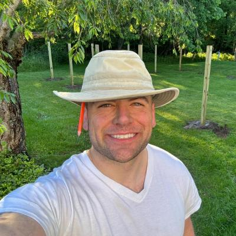
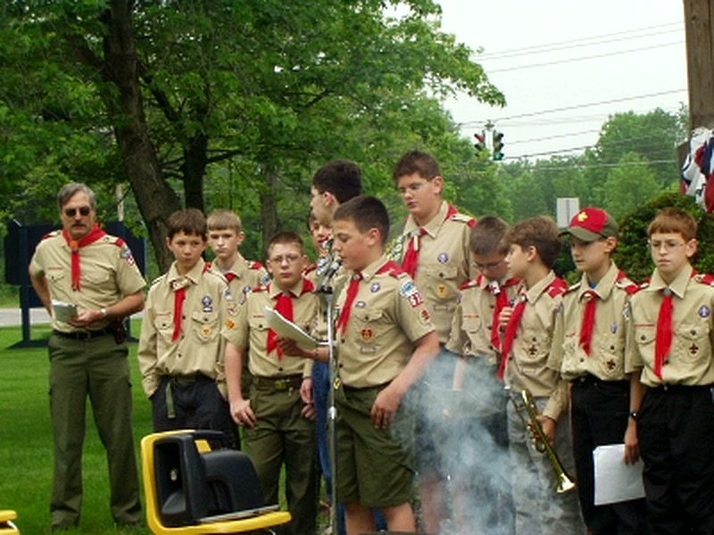

I'm Joe Fusco, a software engineer. I build things with what I know.

I love being a dad. My daughter and I are having fun developing a game together.

<figure class="about-snapshot">

<figcaption>Troop 630.</figcaption>
</figure>

I grew up in Western New York, which made me a Buffalo Bills fan. I moved to Florida for three years, and now I'm back in upstate New York and loving it.

I play alto and tenor saxophone and the piano, and I'm trying to learn the bass. I've been learning about Internal Family Systems and dialectical behavior therapy.

I watch birds. I'm a strong advocate for removing [mulch volcanoes](https://extension.psu.edu/mulching-landscape-trees) ([archived](https://web.archive.org/web/20261103032349/https://extension.psu.edu/mulching-landscape-trees)), so a tree's root flare can breathe.
